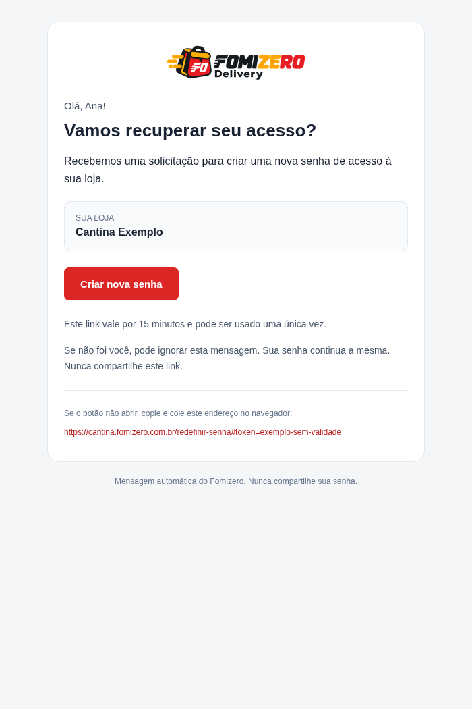

# E-mails de acesso do Fomizero

Três mensagens transacionais usam o mesmo layout HTML em tabelas com estilos inline e alternativa de texto simples. A logo original foi convertida para PNG de 420 × 110 e incorporada como anexo inline CID, conforme o formato da [API Resend](https://resend.com/changelog/embed-images-using-cid). Isso evita depender de DNS/URL pública para buscar a imagem. Leitores podem escolher não exibir imagens; o conteúdo e os links permanecem em texto.



## Eventos

- **Recuperação solicitada:** saudação pelo primeiro nome, restaurante, botão “Criar nova senha”, alternativa copiável, validade de 15 minutos e orientação para quem não reconhece a solicitação. Preserva link de uso único e cooldown existentes.
- **Senha alterada:** enviado após confirmar a troca pelo link ou pela ação administrativa de redefinição. Não inclui senha, token ou link de recuperação. Orienta a entrar com nova senha e como reagir a uma alteração não reconhecida. A ação administrativa também incrementa a versão de credencial, invalidando sessões anteriores na próxima verificação.
- **Boas-vindas:** enviado uma vez após concluir o cadastro canônico `/api/onboarding/tenant`, incluindo cadastros por convite/operador. Informa o endereço de login da nova loja, como retomar a contratação e o que configurar depois. Não contém checkout/SCK, senha, promessa de acesso pago, recibo ou confirmação de assinatura. A rota legada `/auth/register` não recebe esse envio.

Boas-vindas e aviso de senha só são agendados **depois do commit**. Transação recusada não envia. Uma falha de e-mail não desfaz cadastro, checkout ou troca de senha. São tarefas de fundo, sem fila durável ou retentativas automáticas: reinício pode interromper um envio, como na recuperação existente. Não há disparo retroativo para contas antigas.

Chaves de idempotência Resend identificam loja/usuário/tipo/versão da credencial para evitar repetir a mesma mensagem em execução duplicada, dentro do período de retenção do provedor. Isso não substitui uma fila durável nem a idempotência do cadastro.

## Configuração

Reutiliza `RESEND_API_KEY` e `PASSWORD_RESET_BASE_DOMAIN` do backend. Produção: `fomizero.com.br`; staging: `staging.fomizero.com.br`. Host/Origin do visitante não constroem links. Remetente: `Fomizero <acesso@fomizero.com.br>`.

`SALES_SUPPORT_EMAIL`, se configurado com um endereço válido e monitorado, aparece no rodapé e é usado como Reply-To. Sem ele, não inventamos contato nem pedimos resposta ao remetente automático. Não é necessário habilitar recebimento no Resend para esses envios. Manter rastreamento de cliques/aberturas desativado, especialmente por causa dos links de recuperação.

Sem chave de API, os novos avisos de boas-vindas/senha são ignorados sem impedir a operação. A recuperação continua exigindo configuração válida. Dados de nome/restaurante são escapados no HTML. A auditoria registra apenas `accepted`/`failed`, tipo e usuário alvo, sem destinatário, token ou corpo; aceitação pela API não comprova entrega. A alteração não acessa credenciais reais e os testes não enviam mensagens reais.

Não é necessária nova migração além da já existente para recuperação de senha (`20261023_01_admin_recovery`). Deploy no backend inclui o PNG de `app/assets`; não requer publicar um recurso no frontend.

## Prévia e validação

```sh
python scripts/preview_transactional_emails.py --output /tmp/fomizero-email-preview
```

Gera três HTMLs e textos fictícios, sem envio. Somente a prévia troca `cid:` por imagem embutida em data URL para o navegador; a mensagem real mantém o anexo MIME inline. A prévia foi inspecionada em Chromium e em larguras de 320/360/390 px, mas não substitui testes reais em Gmail/Outlook.

Após merge/deploy, solicitar recuperação com uma conta de teste, conferir HTML/logo/botão e concluir a troca para receber a confirmação. Criar uma loja de teste pelo cadastro canônico para conferir boas-vindas e seu endereço. Não é preciso pagar assinatura para validar essas mensagens. Conferir Resend e caixa/spam, protegendo links e chaves em capturas.

Cada solicitação de recuperação bem-sucedida pode consumir **dois e-mails** (link + confirmação); cada cadastro consome mais um. Monitorar a franquia diária compartilhada do Resend, especialmente ao iniciar anúncios.
